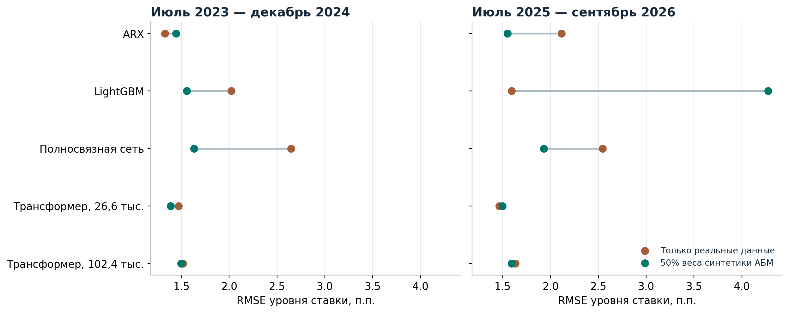
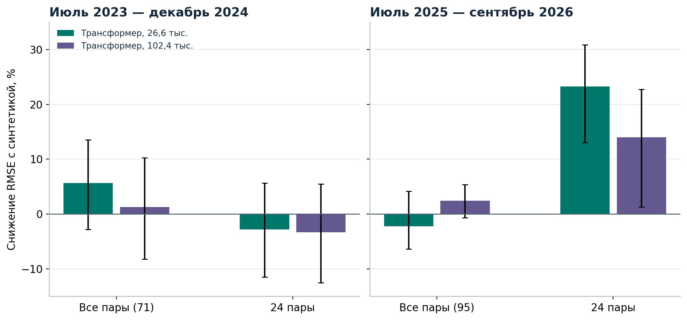

# Синтетика банковской АБМ для прогноза ставок

21 ноября 2026 года

Синтетика дала заметный выигрыш у некоторых прогнозистов и в отдельных периодах. У трансформера с 26,6 тыс. параметров её эффект оказался сильнее при ограничении обучающей выборки, прежде всего в 2025–2026 годах. Из вмешательств в АБМ ослабление прямого переноса ключевой ставки сильнее всего повысило совокупную ошибку ARX и трансформера. Остальные вмешательства заметнее проявились в стресс-сценарии по фондированию и объёму кредитов.

## Дизайн проверки

Цель прогноза — ставки по рублёвым кредитам и вкладам организаций и населения в следующем календарном месяце. Периоды оценки — июль 2023 — декабрь 2024 года (18 месяцев) и июль 2025 — сентябрь 2026 года (15 месяцев). В каждом выпуске использована ключевая ставка по месяц выпуска и последний доступный месячный агрегат банковских ставок с лагом два месяца. Доступность сверена с датами обновления архивных страниц Банка России. Числа из актуального среза рядов. Изменение будущих значений ключевой и ещё не опубликованных ставок оставляло входы прогнозистов неизменными. [Даты выпусков](release_dates.csv) · [пример архивной страницы ЦБ](https://www.cbr.ru/statistics/bank_sector/int_rat/0626/).

Прогнозисты обучены один раз перед первым выпуском каждого периода на 71 и 95 доступных реальных парах соответственно. Для выбора шага обучения сети использовано по 12 более поздних реальных валидационных пар, доступных к первому выпуску. В сравнении с меньшей выборкой берутся 24 равномерно расположенные обучающие метки из тех же дат с исходным 24-месячным контекстом. У всех сетей одинаковые признаки, валидационные даты и бюджет в 700 шагов оптимизации. ARX и LightGBM получают 19 признаков из той же доступной информации: изменения за 1, 3 и 6 месяцев и текущие спреды. Сравнение семейств включает разницу в представлении признаков, сравнение ширины трансформера проводится на одних и тех же входах.

Для каждого варианта АБМ использованы три панели по 300 историй длиной 120 месяцев. У вариантов совпадают траектории ключевой ставки, начальные случайные числа и выборки параметров. Балансовые тождества и включение заданных изменений проверены при генерации. Основной вес синтетики — 50% в функции потерь или половина примеров в пакете обучения. RMSE уровня ставки выражена в п.п. и рассчитана с равным весом каждого месяца, каждой ставки и каждого повтора. Интервалы описательные, по 90%-му парному блочному бутстрэпу с блоком в три месяца внутри каждого периода. [Параметры и матрица сравнений](protocol.json) · [диагностика панелей](panel_diagnostics.csv).

Оба периода уже изучались. В этом прогоне использованы опубликованные агрегаты ставок и исходное правило ценообразования АБМ с калибровкой B на 2017–2021 годах. Проверка состава розничных выдач проведена ранее с ARX. Пересчитанный с января 2024 года ряд даёт слишком мало обучающих пар для трансформера с контекстом 24 месяца. Ставки по вкладам в АБМ взвешиваются по остаткам, а статистика ЦБ отражает новые операции. Вклад этого различия в прогнозную ошибку отдельно не измерялся. [Диагностика состава выдач](../retail_mix/Отчёт.md) · [заметка к встрече](../pilnik_meeting/К%20встрече%20с%20Пильником.md).

## Зависимость от прогнозиста

В столбцах по периодам положительное снижение RMSE означает выигрыш от добавления синтетики.

| Прогнозист | Только реальные данные, RMSE | С полной АБМ, RMSE | Снижение RMSE за 33 месяца | Июль 2023 — декабрь 2024 | Июль 2025 — сентябрь 2026 |
|---|---:|---:|---:|---:|---:|
| ARX | 1,731 | 1,493 | +13,8% | −8,6% | +26,7% |
| LightGBM, 300 итераций | 1,840 | 3,104 | −68,7% | +23,0% | −168,3% |
| Полносвязная сеть, 24 756 параметров | 2,601 | 1,774 | +31,8% | +38,3% | +24,2% |
| Трансформер, 26 628 параметров | 1,468 | 1,439 | +2,0% | +5,6% | −2,2% |
| Трансформер, 102 404 параметра | 1,570 | 1,541 | +1,8% | +1,3% | +2,4% |

RMSE ориентира «последняя доступная ставка» составляет 2,187 п.п. Полносвязная сеть улучшилась в обоих периодах и сохранила более высокую совокупную ошибку, чем обе версии трансформера. У трансформера с 26,6 тыс. параметров 90%-й интервал совокупного снижения RMSE составляет от −3,1% до +7,7%. Результат позволяет оценивать пользу синтетики для конкретных прогнозистов, включая модель без механизма внимания. [Доверительные интервалы и повторы](augmentation_effects.csv) · [ошибки по ставкам](rmse_by_rate.csv).



После первого сравнения дополнительно проверены доли синтетики 10%, 25% и 50% у LightGBM с выбором числа итераций по реальной валидации. С весом 25% совокупная RMSE снизилась с **2,048 до 1,895 п.п.** по сравнению с LightGBM, настроенным тем же способом на реальных данных. В июле 2025 — сентябре 2026 года все проверенные положительные веса увеличили ошибку, при 25% с 1,627 до 2,251 п.п. В основном сравнении в этом периоде сильнее всего выросли ошибки ставок по вкладам. Для статьи стоит сохранить LightGBM и заранее фиксировать способ выбора веса синтетики и числа итераций. [Чувствительность LightGBM](boosting_sensitivity.csv) · [ошибки по ставкам](rmse_by_rate.csv).

## Размер сети и количество реальных данных

У двух трансформеров по два слоя и две головы внимания. Ширина представления составляет 32 и 64, число параметров — 26 628 и 102 404. Ширина промежуточного слоя меняется пропорционально. Полносвязная сеть с 24 756 параметрами читает тот же вход из 24 месяцев.

| Параметры трансформера | Снижение RMSE на всех парах | Снижение RMSE на 24 парах | На 24 парах в 2023–2024 | На 24 парах в 2025–2026 |
|---|---:|---:|---:|---:|
| 26 628 | +2,0% | +13,7% | −2,8% | +23,2% |
| 102 404 | +1,8% | +6,4% | −3,3% | +14,0% |

У трансформера с 26,6 тыс. параметров сокращение обучающих пар увеличило совокупный эффект синтетики на 11,7 п.п. с описательным 90%-м интервалом от 3,0 до 18,9 п.п. На 24 парах синтетика снизила итоговую ошибку с 1,840 до 1,588 п.п. Ошибка той же сети на всех реальных парах составила 1,468 п.п. Эффект малой выборки в этом дизайне сосредоточен во втором периоде. При полном наборе пар изменение ширины практически не изменило совокупный выигрыш от синтетики. [Парные оценки и интервалы](capacity_and_sample_effects.csv) · [абсолютные ошибки](augmentation_effects.csv).



## Механизмы АБМ и линейный двойник

Каждое вмешательство проверено отдельно на параметрах исходной калибровки. Положительное изменение в таблице означает рост RMSE относительно обучения на синтетике полной АБМ за 33 месяца.

| Изменение источника синтетики | ARX | Трансформер, 26 628 параметров | LightGBM, 300 итераций |
|---|---:|---:|---:|
| Прямой перенос ключевой ставки ослаблен вдвое | +20,2% | +9,3% | −2,3% |
| Новые межбанковские сделки запрещены | +0,9% | +1,2% | +1,3% |
| Выравнены размеры и часть стартовых и поведенческих параметров банков | +3,8% | +1,1% | +3,3% |
| Убран прямой отклик целевых ставок на давление ликвидности | −0,5% | −1,8% | −2,7% |
| Полная АБМ заменена её линейным VARX-двойником | +0,2% | +1,3% | +8,8% |

Ослабление прямого переноса подняло ошибку ARX в обоих периодах, а у трансформера главным образом в 2023–2024 годах. Для ARX совокупная RMSE составила 1,493 п.п. с полной АБМ и 1,496 п.п. с её двойником. Для трансформера соответствующие ошибки — 1,439 и 1,457 п.п., при 1,468 п.п. с одними реальными данными. VARX оценивается по выходам полной АБМ, поэтому проверяет, достаточно ли её линейной динамики для прогноза. Изменение прямого переноса — отдельный тест чувствительности к правилу ставок. [Ошибки и интервалы по периодам](ablation_effects.csv).

Вмешательство в ценообразование оставляет ликвидность действующим ограничением в балансе и фондировании. Выравнивание банков сохраняет структурные роли в межбанке и индивидуальные шоки. Оценки зависят от того, какие именно параметры изменены, а также от выбранных прогнозных дат и прогнозиста.

В отдельном штатном сценарии скачка ключевой ставки на 9 п.п. и оттока вкладов рассмотрены 12 месяцев после шока и 30 парных запусков. Значения ниже — средние по запускам от показателей каждой траектории.

| Вариант АБМ | МБК за период, % активов | Максимальный долг перед ЦБ, % активов | Наибольшее падение кредитного портфеля |
|---|---:|---:|---:|
| Полная | 0,54 | 0,66 | 10,30% |
| Без новых межбанковских сделок | 0,00 | 1,05 | 13,72% |
| Без прямого влияния ликвидности на ставки | 0,59 | 8,35 | 11,06% |
| С выровненными параметрами банков | 1,16 | 0,58 | 9,32% |

Стресс меняет спрос на фондирование, межбанковскую активность и кредитование даже там, где мала разница в прогнозной RMSE ставок. Это результаты сценария внутри АБМ. Для отдельной работы об этих механизмах потребуется сопоставление с наблюдаемыми показателями фондирования, межбанка и объёмов кредитов. [Сводка стресс-сценария](stress_summary.csv) · [парные результаты по запускам](stress_by_seed.csv).

## Вопрос для первой статьи

**Когда синтетика банковской АБМ улучшает месячный прогноз ставок по кредитам и вкладам, как эффект зависит от прогнозиста и какую роль играет перенос ключевой ставки?**

Сравнение с ARX, LightGBM и полносвязной сетью позволяет оценить переносимость результата. Два размера трансформера и ограничение числа реальных пар проверяют возможную зависимость от ёмкости сети и охвата выборки. Характеристики архитектуры относятся к методике статьи. В её основном результате стоит показать процентный канал и линейного двойника. По трём остальным механизмам достаточно таблицы с оценками их вклада в ошибки ставок. Итоговая проверка требует заранее зафиксировать конфигурации прогнозистов, способ подбора веса синтетики и окно оценки на новых выпусках. [Протокол текущего прогона](protocol.json).

Для методического обоснования сравнений подходят работа Grinsztajn, Oyallon и Varoquaux о деревьях и сетях на табличных данных и работа Semenoglou, Spiliotis и Assimakopoulos об аугментации обучения прогноза при разном числе реальных рядов. [Табличный бенчмарк](https://arxiv.org/abs/2207.08815) · [Эксперименты с аугментацией временных рядов](https://www.sciencedirect.com/science/article/pii/S0031320322006124).

## Воспроизведение

Команды выполняются в каталоге отчёта из Python-окружения модели с PyTorch, LightGBM, PyArrow и Matplotlib. Скрипты определяют корень репозитория по своему расположению. Альтернативный путь можно указать в `ABM_BANKS_REPO`. Архив дат сохранён в `release_dates.csv`.

```sh
export PYTHONDONTWRITEBYTECODE=1 OPENBLAS_NUM_THREADS=1 VECLIB_MAXIMUM_THREADS=1 OMP_NUM_THREADS=1
python generate_panels.py --jobs 10
python check_forecasts.py --family tabular --jobs 4
python check_forecasts.py --family neural --jobs 6
python summarize.py
python stress_check.py
python boosting_sensitivity.py
python plot.py
```

[Прогнозы ARX и LightGBM](predictions_tabular.csv) · [прогнозы сетей](predictions_neural.csv) · [прогнозы проверки LightGBM](boosting_sensitivity_predictions.csv).
