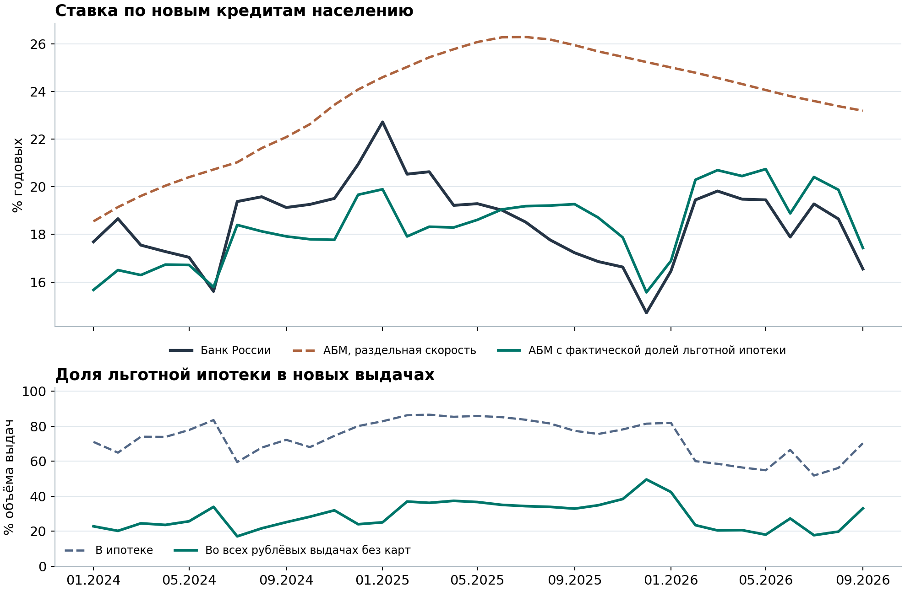

# Льготная ипотека и ошибка розничной ставки в АБМ

21 ноября 2026 года

**В январе 2024 — сентябре 2026 года льготная ипотека составляла 28,5% рублёвых выдач населению без оборота по кредитным картам.** При сопоставлении с расчётной ставкой без федеральной льготной ипотеки среднее завышение ставки АБМ с раздельной скоростью снизилось с **+5,04 до −0,26 п.п.** На том же отрезке пересчёт изменил и сравнение скоростей. Исходная АБМ стала ближе к расчётному отклику розничной ставки без льготной ипотеки. [Помесячные данные и расчёты](monthly_comparison.csv).

## Какие выдачи сравниваются

АБМ различает кредиты организациям и населению. Все новые выдачи населению используют одно розничное правило ценообразования и один параметр амортизации. Итоговая модельная ставка взвешивается по объёмам новых розничных выдач банков. Явного деления по ипотеке, автокредитам, прочим потребкредитам и программам господдержки в текущей реализации нет. [Сегменты и параметры модели](../../abm_banks/config.py#L24), [агрегирование ставок](../../abm_banks/model.py#L1003).

Ставка Банка России по всем новым рублёвым кредитам населению взвешена по суммам выдач и исключает кредитные карты, часть плавающих ставок и другие операции. Общий объём выдач из статистики кредитования физлиц включает карты. Поэтому из общего объёма вычтен оборот по картам, восстановленный по векторным столбцам рисунка 6 ипотечного бюллетеня. Сумма пяти категорий рисунка отличается от табличного общего оборота максимум на 2,36 млрд руб. за месяц. Объём ипотеки на рисунке отличается от табличного максимум на 0,36 млрд руб. Различия в охвате форм 0409128 и 0409316 сохраняются, поэтому получившийся знаменатель — приближение объёма операций под наблюдаемой ставкой. [Методология ставок Банка России](https://www.cbr.ru/Content/Document/File/135988/meth_rates.pdf), [ипотечный бюллетень за сентябрь 2026 года](https://www.cbr.ru/Collection/Collection/File/62505/mortgage_lending_market_2609_77.pdf).

В расчёт вошли федеральные программы из таблицы 7а бюллетеня. Для месячных ставок использованы числа из графика комментария ЦБ, сверенные с графиком ипотечного обзора. Наблюдаемая ставка по всем новым кредитам совпала с рядом проекта во всех 33 месяцах. Модельные ряды воспроизведены по прежнему пути ключевой ставки и 50 зёрнам. Среднее смещение за весь предыдущий отрезок с января 2022 по сентябрь 2026 составляет +4,07 п.п. Сравнения ниже используют одинаковый 33-месячный отрезок, на котором доступны нужные компоненты. [Таблицы бюллетеня](https://www.cbr.ru/Collection/Collection/File/62506/mortgage_lending_market_2609_77.xlsx), [комментарий к ставкам](https://www.cbr.ru/statistics/bank_sector/int_rat/0926/), [обзор ипотеки](https://www.cbr.ru/statistics/bank_sector/mortgage/indicator_mortgage/0926/).

| Период | Вся ипотека в выдачах без карт | Льготная ипотека в выдачах без карт | Ставка по льготной ипотеке, % годовых |
|---|---:|---:|---:|
| 2024 | 34,1% | 25,1% | 5,85 |
| 2025 | 45,3% | 36,9% | 5,68 |
| Январь–сентябрь 2026 | 39,2% | 24,7% | 5,67 |
| Все 33 месяца | 38,8% | 28,5% | 5,74 |

Доли и льготные ставки взвешены по объёму. Месячная доля льготной ипотеки во всех выдачах без карт менялась от 17% до 50%. Для 2022–2023 годов по опубликованным годовым данным можно надёжно установить долю в **полном** обороте, включая карты. Она составила 12,7% в 2022 и 18,3% в 2023 году. Этот знаменатель отличается от приближения, использованного в основной помесячной проверке. [Годовые данные Банка России](https://www.cbr.ru/Collection/Collection/File/64532/analytical_review_bs-2026-3.pdf), [сводка по годам](annual_context.csv).

## Как состав меняет сравнение ставок

Пусть `w` — доля льготной ипотеки, `r_льг` — ставка по ней, а `r_ЦБ` — опубликованная ставка по всем новым розничным кредитам. Расчётная ставка по остальным выдачам равна `(r_ЦБ − w × r_льг) / (1 − w)`. Этот пересчёт в среднем прибавляет **5,30 п.п.** к опубликованной ставке. Если те же льготные выдачи условно оценить по ставке рыночной ипотеки и сохранить их вес, средний сдвиг составит **4,22 п.п.** Деление льготных выдач на весь оборот с картами занижает их вес в агрегате ставки. Оно даёт сдвиг при исключении льготных выдач всего на 1,94 п.п.

**Август–сентябрь 2026 года** показывает, насколько это важно. Объём льготных выдач вырос с 213,6 до 433,5 млрд руб. Его доля в выдачах без карт выросла с 19,7% до 33,0% при ключевой 14% в обоих месяцах. Ставка Банка России снизилась с 18,65% до 16,55%, а расчётная ставка по остальным выдачам почти не сдвинулась, 21,86% и 21,87% соответственно. В сентябре АБМ с раздельной скоростью дала 23,19%. Её разрыв с опубликованной ставкой составил 6,64 п.п., с расчётной ставкой без льготной ипотеки — 1,32 п.п. [Обзор Банка России за сентябрь](https://www.cbr.ru/statistics/bank_sector/mortgage/indicator_mortgage/0926/), [помесячная сверка](monthly_comparison.csv).

### Если сопоставить выход АБМ с агрегатом ЦБ

Для отдельной проверки модельную розничную ставку трактовали как цену прочих выдач. В расчётном агрегате доле `w` назначили фактическую ставку по льготной ипотеке, а доле `1 − w` — ставку симулятора. Это пересчёт измеряемого выхода по наблюдаемым месячным весам и ставкам. В самих прогонах динамика балансов, спроса и предложения определялась прежним кодом.

| Версия АБМ | RMSE уровня до пересчёта | RMSE уровня с фактической смесью | Среднее смещение с фактической смесью |
|---|---:|---:|---:|
| Исходная общая скорость | 6,85 | **1,09** | +0,84 |
| Раздельная розничная скорость | **5,65** | 1,40 | −0,21 |

Все ошибки в п.п., каждый месяц имеет одинаковый вес. В раздельной версии среднее смещение против расчётного ряда без федеральной льготной ипотеки составляет −1,56 п.п. в 2024 году, −0,10 в 2025 и +1,26 в январе–сентябре 2026. Поэтому близкое к нулю среднее за 33 месяца сочетается с остаточными расхождениями по периодам. [Сводка ошибок уровней](summary.csv).



## Что это меняет в выводе о скорости

Дополнительно повторены прежние локальные проекции на общем отрезке и горизонтах 0, 1, 3 и 6 месяцев. С одной стороны, модельные ряды без пересчёта сопоставили с расчётным рядом без федеральной льготной ипотеки. С другой стороны, выход обеих АБМ пересчитали с фактической смесью и сравнили с опубликованной ставкой. Параметры АБМ взяты из предыдущих прогонов.

| Ряд сравнения | Исходная скорость, RMSE отклика | Раздельная скорость, RMSE отклика |
|---|---:|---:|
| Опубликованный агрегат, выход АБМ как раньше | 0,611 | **0,197** |
| Расчётная ставка ЦБ без льготной ипотеки, выход АБМ как раньше | **0,551** | 1,266 |
| Опубликованный агрегат, выход АБМ с фактической смесью | **0,478** | 0,899 |

В двух сопоставлениях с учётом льготного компонента исходная АБМ воспроизводит отклик точнее. Результат о преимуществах медленной розничной скорости относится к прежнему сопоставлению с общим агрегатом. В нём замедление могло частично компенсировать отсутствие меняющейся доли дешёвых выдач. Этот ретроспективный тест на коротком отрезке оценивает исторические отклики при фактическом составе, поэтому для вывода о скорости ценообразования нужен последовательный подбор на согласованном ряде и проверка на другом отрезке. [Локальные проекции](exploratory_lp.csv), [таблица ошибок](exploratory_lp_rmse.csv).

Для исследования переносов следующий этап — явно задать, какой ряд ставок должна воспроизводить модель, и оценить скорость на нём. Фиксированные фактические доли подходят для исторической диагностики агрегирования. Для контрфактического эксперимента с изменением условий господдержки понадобятся эндогенные доли выдач и отдельные ставки для заёмщика и банка с учётом субсидии.

## Воспроизведение

В папке `sources` лежат исходные таблицы, комментарии и график Банка России. `replay.py` использует конфиги из проверки розничной скорости и проверяет совпадение исходного среднего смещения. `compare.py` читает исходные данные и создаёт помесячную сверку, сводку и годовой контекст. Для него нужны `numpy`, `pandas`, `openpyxl` и `pdfplumber`. Остальные скрипты используют окружение модели.

```sh
python replay.py --jobs 8
python compare.py
python diagnose_dynamics.py
python plot.py
```
