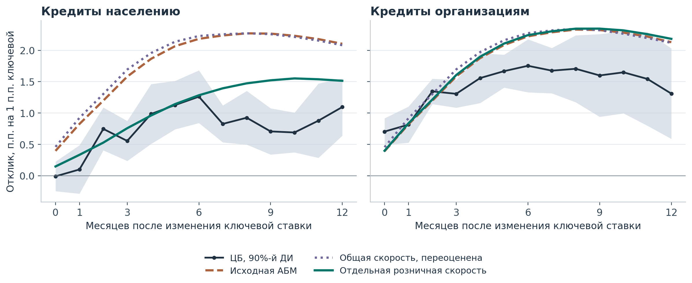
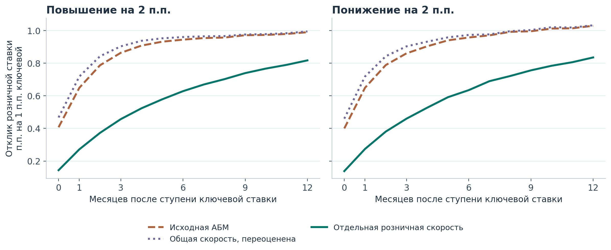
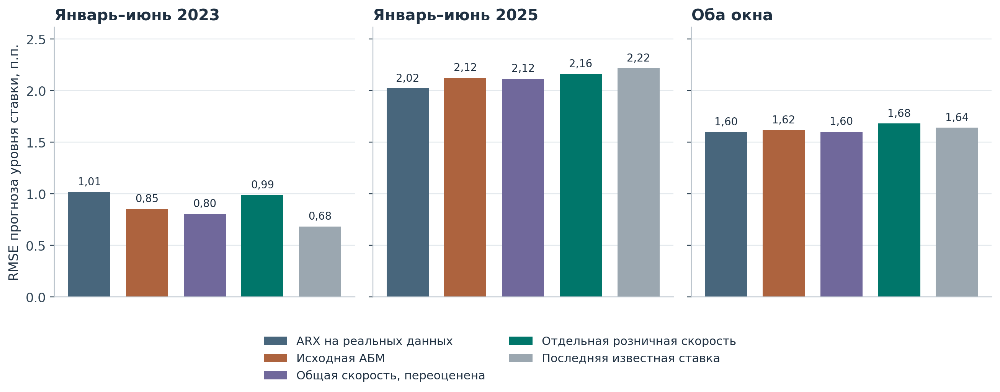

# Раздельная подстройка кредитных ставок в банковской АБМ

21 ноября 2026 года

**Отдельная скорость подстройки улучшила воспроизведение розничного отклика.** Среднеквадратичное расхождение с наблюдаемым откликом упало с 0,805 до 0,174 п.п. на 1 п.п. изменения ключевой ставки. Ошибка корпоративного отклика выросла с 0,315 до 0,325 и уложилась в заданный допуск. Прогнозный тест дал другой результат. В прежнем ARX на 12 датах ошибка прогноза с новой синтетикой выросла с 1,62 до 1,68 п.п.

## Что изменилось в модели

При исходной калибровке банк за месяц закрывал одинаковую долю разрыва до целевой ставки по кредитам населению и организациям. Новый параметр `banks.rate_speed_loan_retail_shift` задаёт отдельный сдвиг розничной скорости. Если `v` — индивидуальная скорость банка до ограничения, для организаций применяем `clip(v, 0.05, 0.90)`, для населения — `clip(v + δ, 0.05, 0.90)`. Удельный перенос ключевой ставки в **целевую** кредитную ставку равен единице в обоих сегментах во всех трёх версиях. Изменение скорости влияет на розничную ставку в данном месяце, а через баланс банка и поведение клиентов может влиять на другие результаты в последующие месяцы.

| Версия | Центр скорости для организаций | Центр скорости для населения |
|---|---:|---:|
| Исходная калибровка B | 0,407 | 0,407 |
| Заново подобранная общая скорость | 0,468 | 0,468 |
| Отдельная розничная скорость | 0,407 | 0,142 |

Это центры распределения до ограничения скоростей отдельных банков. В исследовательском конфиге указан сдвиг δ = −0,26444. Настройка доступна в интерфейсе и в JSON. В старых конфигах модель принимает δ = 0. [Правило ценообразования](../../abm_banks/model.py#L351), [исследовательский конфиг](results/config_retail_speed.json).

## Как проверялось

Протокол и пороги записаны локально до прогона. Каждая изменённая версия подбиралась по одному параметру на одной сетке с одинаковым критерием. Критерий — расхождение локальных проекций для обоих кредитных сегментов на горизонтах 0, 1, 3 и 6 месяцев с равными весами. Для подбора использовались январь 2014 — декабрь 2021 и 16 общих зёрен. Остальные параметры взяты из калибровки B.

Для проверки использовались январь 2022 — сентябрь 2026, 24 месяца исторического разогрева и 50 новых зёрен. Реальные и симулированные ряды имели одинаковую траекторию ключевой ставки. В данных и в симуляциях мы оценили коэффициент при месячном изменении ключевой в уравнении накопленного изменения кредитной ставки с тремя лагами каждой из двух переменных. Это мера условной связи в наблюдаемой истории. Внутри симулятора дополнительно сравнили повышение и понижение ключевой на 2 п.п. с постоянной ставкой при тех же зёрнах. [Протокол](protocol.json), [данные Банка России](https://www.cbr.ru/statistics/bank_sector/int_rat/).

Проверочный период находился за пределами подбора, а общая проблема быстрого отклика на нём была известна из предыдущей диагностики. Поэтому его можно использовать для проверки параметра вне калибровки и для оценки размера улучшения. Для независимой проверки вывода потребуется следующий отрезок данных или отдельный заранее выбранный розничный ряд.

## Отклик ставок

| Версия | Ошибка для населения | Ошибка для организаций | Общая ошибка по двум сегментам |
|---|---:|---:|---:|
| Исходная АБМ | 0,805 | 0,315 | 0,611 |
| Общая скорость, переоценена | 0,884 | 0,352 | 0,673 |
| Отдельная розничная скорость | **0,174** | 0,325 | **0,261** |

В таблице RMSE отклика в п.п. на 1 п.п. изменения ключевой. Все три условия основного критерия выполнены. Розничная ошибка сократилась на **78%**, корпоративная выросла на **3,3%**, общая ошибка ниже, чем у заново подобранной общей скорости. Если начинать оценивать отклик с января 2023 года, розничная ошибка снижается с 0,903 до 0,302. На общей выборке улучшение есть во всех 50 парных сравнениях по зёрнам. Это проверка чувствительности к случайности симулятора. [Таблица откликов](results/validation_rmse.csv), [результат по каждому зерну](results/historical_by_seed.csv).



| Месяцев после изменения ключевой | Данные ЦБ, население | Исходная АБМ | Отдельная розничная скорость |
|---|---:|---:|---:|
| 0 | −0,01 | 0,40 | 0,15 |
| 1 | 0,10 | 0,83 | 0,33 |
| 3 | 0,56 | 1,58 | 0,76 |
| 6 | 1,26 | 2,18 | 1,28 |
| 12 | 1,10 | 2,10 | 1,51 |

Первые четыре горизонта входят в критерий. В месяц изменения ключевой и после полугода остаются заметные расхождения на отдельных горизонтах. На шестом месяце модель близка к эмпирической оценке. Отклик объёма кредитов населению на тех же четырёх горизонтах воспроизводится немного хуже. Его RMSE увеличился с 0,856 до 0,911 в логарифмических п.п. на 1 п.п. изменения ключевой. [Коэффициенты по горизонтам](results/historical_lp.csv), [оценки по данным и интервалы](results/observed_lp.csv).

При фиксированной ступени в симуляторе новая версия передаёт повышение ключевой медленнее. В первый месяц отклик на 1 п.п. ключевой снижается с 0,41 до 0,14 п.п., на шестом месяце — с 0,94 до 0,63 п.п. Зеркальная проверка при понижении даёт близкую картину. [Парные сценарии](results/step.csv).



### Дополнительные проверки после основного прогона

- При одинаковом замедлении **обоих** сегментов розничный RMSE отклика тоже падает до 0,179, а корпоративный растёт до 0,493 против 0,325 при раздельных скоростях. Преимущество разделения здесь в качестве совместного воспроизведения двух сегментов.
- При розничной скорости в 50% от исходной вместо 35% ошибка розничного отклика составляет 0,349 против исходных 0,805. Лучшие совместные ошибки на сетке подбора для этих двух скоростей почти одинаковы. Мы получили подтверждение более медленной подстройки, а конкретная величина зависит от калибровочного критерия.
- На уже реализованном пути ключевой RMSE **уровня** розничной ставки снижается с 5,88 до 4,69 п.п. Среднее завышение остаётся большим и составляет 4,07 п.п. против прежних 5,36 п.п. Это прямое сравнение уровней при фактической ключевой. [Чувствительность к скорости](results/exploratory_speed_sensitivity.csv), [ошибки уровней](results/exploratory_rate_levels.csv).

## Прогноз с синтетическими данными

В ограниченном ретроспективном тесте использован прежний ARX для ставки по новым кредитам населению на следующий календарный месяц. Варианты с АБМ получали 50% веса синтетики. Для каждой версии сгенерировали 300 историй по 120 месяцев при каждом из трёх генераторных зёрен. Траектории ключевой и все параметры, кроме проверяемой скорости, совпали между версиями. Даты в архиве ЦБ дали двухмесячный лаг входной ставки во всех 12 выпусках. Значения рядов взяты из нынешнего исторического среза. ARX обучен отдельно по отсечке первого выпуска в каждом окне. [Архив дат](../confirmation/cbr_release_dates.csv), [прогнозы и ошибки](results/forecast_errors.csv).

| Окно | ARX на реальных данных | + исходная АБМ | + общая скорость | + отдельная розничная скорость | Последняя известная ставка |
|---|---:|---:|---:|---:|---:|
| Январь–июнь 2023 | 1,015 | 0,852 | 0,804 | 0,989 | 0,682 |
| Январь–июнь 2025 | 2,021 | 2,123 | 2,117 | 2,162 | 2,217 |
| Оба окна | **1,599** | 1,617 | 1,601 | 1,681 | 1,640 |

В таблице RMSE уровня ставки в п.п. с равными весами по месяцам и генераторным зёрнам. Отдельная розничная скорость ухудшила прогноз относительно исходной синтетики на 3,9%. Знак результата сохраняется при исключении любой одной даты, ухудшение от 2,8% до 8,1%. При 12 наблюдениях это описательное сравнение для данной спецификации ARX. [Результаты по зёрнам](results/forecast_rmse_by_seed.csv), [чувствительность по датам](results/forecast_leave_one_month.csv).



## Что можно использовать в исследовании

Раздельную скорость стоит использовать как проверенную спецификацию для экспериментов с **динамикой переноса** в розничные ставки. Исходная калибровка B остаётся контрольной спецификацией для сравнения. Для статьи можно разделить два результата. Историческое расхождение отклика существенно сокращается при разделении скоростей, а экономическая валидация этого механизма и полезность синтетики для ARX дают разные оценки одной модификации.

Следующий вопрос о качестве АБМ возникает из ошибки **уровня** ставки. Сопоставить модель отдельно с рыночной ипотекой, льготной ипотекой и остальной розницей, где позволяют объёмы выдач и сопоставимость рядов. В агрегате ЦБ изменение состава выдач само по себе способно сдвигать наблюдаемую ставку. В частности, Банк России связывает снижение долгосрочной розничной ставки в сентябре 2026 года с ростом льготных ипотечных выдач. Это конкретный механизм для проверки оставшегося завышения. [Комментарий Банка России за сентябрь 2026 года](https://cbr.ru/statistics/bank_sector/int_rat/0926/).

## Воспроизведение

Команды выполняются из каталога отчёта. Скрипты определяют корень репозитория по своему расположению. Переменная `ABM_BANKS_REPO` позволяет указать альтернативный путь к модели.

```sh
python validate_transfer.py --jobs 8
python validate_forecast.py --jobs 12
python diagnose.py --jobs 5
python plot.py
```

В рабочей копии прошли 123 теста модели. На девяти контрольных прогонах с δ = 0 таблицы сектора, банков и событий побайтно совпали с исходным кодом. При исторических и парных экспериментах проверялись балансовые тождества на каждом шаге. 108 контрольных исторических прогнозов воспроизведены до последнего сохранённого знака. Декабрьский проспективный выпуск и его протокол прошли повторную сверку контрольных сумм.
