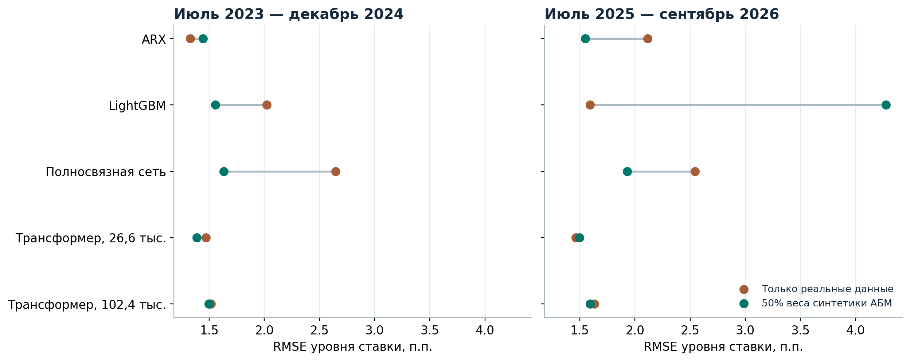
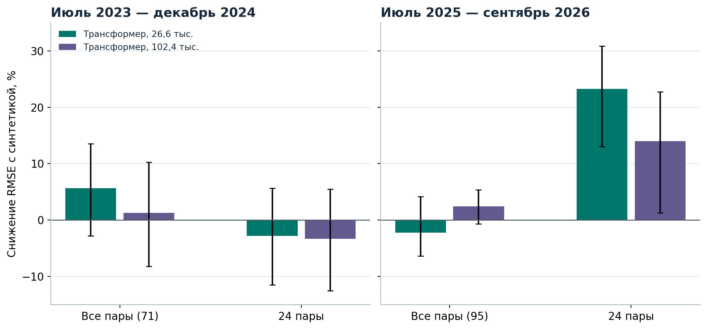
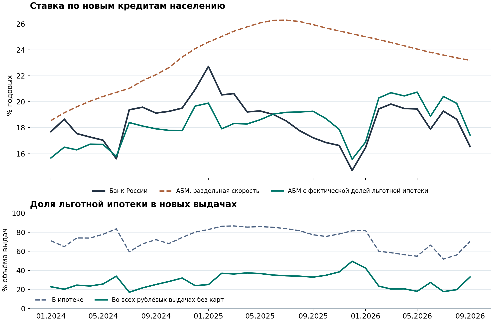

# Синтетические данные банковской агентной модели в прогнозировании процентных ставок

*Рабочая версия от 22 ноября 2026 года*

## Аннотация

В работе оценивается, когда синтетические данные агентной модели банковского сектора России повышают точность прогноза ставок по кредитам и вкладам на месяц вперёд. На 33 прогнозных месяцах сравниваются линейная модель ARX, градиентный бустинг, полносвязная сеть и трансформеры двух размеров. Эффект синтетики различается между прогнозистами и периодами. Для ARX корень из средней квадратической ошибки (RMSE) снизился с 1,731 до 1,493 п.п. Линейный двойник, оценённый по траекториям симулятора, обеспечил почти ту же ошибку, 1,496 п.п. Ослабление прямого переноса ключевой ставки в АБМ вдвое повысило ошибку на 20,2% у ARX и на 9,3% у трансформера с 26,6 тыс. параметров относительно исходной АБМ. Три других вмешательства в правила межбанка, ликвидности и неоднородности дали меньшие эффекты у этих прогнозистов. В дополнительной проверке кредитов населению учёт федеральной льготной ипотеки изменил оценку качества воспроизведения процентного отклика.

**Ключевые слова** · агентное моделирование, синтетические данные, прогнозирование банковских ставок, перенос ключевой ставки, процентный канал денежно-кредитной политики.

## 1. Введение

Агентная модель банковского сектора задаёт правила, по которым изменение ключевой ставки передаётся в ставки банков, решения заёмщиков и вкладчиков и состояние банковских балансов. Симулятор позволяет получить множество траекторий при разных путях ключевой ставки. Эти траектории можно добавить к наблюдаемым данным при обучении прогнозиста. Возникает вопрос, какие свойства симулятора определяют ценность таких данных. Например, выигрыш в точности может быть связан с тем, что симулятор воспроизводит лаги и величину переноса ключевой ставки. В таком случае близкий результат может дать линейное описание его динамики.

Агентные модели применяются непосредственно для макроэкономического прогнозирования, в том числе на эпизодах кризисов. Кошелев, Пономаренко и Селезнев обучают нейросеть на симуляциях, чтобы ускорить построение условных и безусловных прогнозов в АБМ. В литературе о расширении обучающей выборки временных рядов также исследуется, как эффект синтетики зависит от объёма данных и ёмкости сети. В нашем эксперименте синтетические траектории дополняют доступную историю банковских ставок, а результат измеряется по прогнозам наблюдаемых ставок. [Hommes и Poledna, 2026](https://doi.org/10.1016/j.econmod.2026.107497) · [Кошелев и др., 2023](https://www.cbr.ru/statichtml/file/149733/wp_115.pdf) · [Semenoglou и др., 2023](https://doi.org/10.1016/j.patcog.2022.109132)

Подход связан с использованием структурной модели как источника информации для статистической, например с априорными распределениями для VAR на основе модели общего равновесия. Для валидации АБМ Guerini и Moneta сопоставляют динамические структуры, оценённые по искусственным и наблюдаемым данным. Мы используем линейную проекцию выходов АБМ как контроль в прогнозном эксперименте. Для выделения конкретного правила дополняем это сравнение парными симуляциями, в которых изменяем механизм переноса ключевой ставки. Выбор этого механизма мотивирован эмпирическими результатами по России, где скорость и величина реакции отличаются по сегментам кредитного и депозитного рынка. [Del Negro и Schorfheide, 2004](https://doi.org/10.1111/j.1468-2354.2004.00139.x) · [Guerini и Moneta, 2017](https://www.sciencedirect.com/science/article/abs/pii/S0165188917301367) · [Егоров и Борзых, 2018](https://doi.org/10.18288/1994-5124-2018-1-04)

Исследуем, **когда синтетика банковской АБМ улучшает месячный прогноз ставок по кредитам и вкладам, как эффект зависит от прогнозиста и какую роль играет перенос ключевой ставки**. Внутри каждого прогнозного метода сопоставляем обучение на наблюдениях и на смеси наблюдений с синтетикой. Затем при той же постановке заменяем полную АБМ её линейным двойником или симулятором с изменённым правилом. Для кредитов населению дополнительно проверяем, как на оценку механизма ставок влияет состав выдач.

## 2. Агентная модель и данные

### 2.1. Ставки в модели

Сектор представлен 20 банками на старте симуляции. Банки различаются размером, капиталом, целевыми запасами ликвидности, кредитным риском и скоростью подстройки ставок. Заёмщики и вкладчики представлены агрегированным спросом с распределением по банкам. Банки выдают кредиты с учётом капитала, перераспределяют ликвидность через межбанковский рынок и могут обращаться к фондированию Банка России. Шаг модели равен одному месяцу. Путь ключевой ставки задаётся извне. [Спецификация АБМ](../docs/MODEL.md)

Для каждой из четырёх ставок банк рассчитывает целевую ставку $r^*_{i,s,t}$, где $i$ — банк, а $s$ — вид операции и клиентский сегмент. Прямой вклад ключевой ставки в цель имеет вид $k_0+\beta_s(k_t-k_0)$, где $k_0$ — опорное значение ключевой ставки на старте истории. В зависимости от вида операции цель включает спред, премию за риск, положение банка по ликвидности, капиталу и другие условия ценообразования. Банк закрывает долю $\lambda_{i,s}$ разрыва до цели за месяц.

$$
r_{i,s,t}=r_{i,s,t-1}+\lambda_{i,s}(r^*_{i,s,t}-r_{i,s,t-1}).
$$

В исходной версии $\beta_s=1$ во всех четырёх ставках. Коэффициент $\beta_s$ относится к целевой ставке, а наблюдаемый отклик агрегата также зависит от скорости подстройки, состояния балансов и весов отдельных банков. Используется калибровка B на данных января 2017 — декабря 2021 года. В её целевую функцию входят средние темпы роста кредитов и вкладов, спреды банковских ставок к ключевой и показатели переноса по четырём ставкам. [Реализация ценообразования](../abm_banks/model.py#L351) · [Сохранённая калибровка](../abm_banks/data/calibrated_window_B.json)

### 2.2. Наблюдаемые ряды и дата выпуска

Используем месячные рублёвые ставки Банка России по кредитам и вкладам населения и организаций. Реальная история для прогнозного эксперимента начинается в январе 2014 года. Прогноз выпускается в конце месяца $t$ на следующий календарный месяц $t+1$. Входная информация включает ключевую ставку по месяц выпуска и банковские ставки по месяц $t-2$. Этот лаг гарантирует доступность банковских ставок во всех выпусках двух окон по датам обновления архивных страниц Банка России. Исторические значения взяты из сохранённого среза рядов. Поэтому эксперимент восстанавливает доступность наблюдений по датам, а возможные более ранние редакции значений остаются источником неопределённости. [Статистика ставок Банка России](https://www.cbr.ru/statistics/bank_sector/int_rat/) · [Архив дат публикации](learner_mechanisms/release_dates.csv)

Первое окно включает 18 целевых месяцев с июля 2023 по декабрь 2024 года, второе — 15 месяцев с июля 2025 по сентябрь 2026 года. Перед первым выпуском каждого окна прогнозисты обучаются один раз. В следующих выпусках обновляется доступный контекст. Число реальных обучающих пар равно 71 и 95 соответственно. Для выбора шага обучения нейросетей выделено ещё по 12 хронологически более поздних пар с метками, известными до первого выпуска. Оба окна изучались ранее, поэтому анализ носит ретроспективный характер. [Разбиение и проверка доступности входов](learner_mechanisms/forecast_data.py)

## 3. Прогнозный эксперимент

### 3.1. Источники синтетических данных

Для полной АБМ и каждого изменения генерируем три панели по 300 историй длительностью 120 месяцев после прогрева. Траектории ключевой ставки включают случайные скачки. Параметры части правил варьируются около калибровки. Между вариантами АБМ совпадают траектории ключевой ставки, исходные случайные числа и выборки параметров. На каждом шаге проверяются балансовые тождества. Для каждого вмешательства проверяется, что соответствующее правило сработало. [Код генерации](learner_mechanisms/generate_panels.py) · [Диагностика панелей](learner_mechanisms/panel_diagnostics.csv)

Линейный двойник — VARX, оценённая по выходам исходной АБМ для каждой панели. Вектор состояния включает четыре ставки и четыре темпа роста объёмов кредитов и вкладов. В уравнения входят собственные лаги вектора состояния, текущая ключевая ставка и 12 её лагов. Число лагов состояния выбирается по информационному критерию BIC с проверкой устойчивости. Двойник сохраняет путь ключевой ставки, начальные значения состояния и константу каждой истории. Инновации формируются выборкой векторов остатков. Сгенерированные ставки ограничены снизу 0,1% годовых. Сравнение с двойником показывает, какую прогнозную точность даёт синтетика, построенная на такой аппроксимации динамики АБМ. [Реализация линейного двойника](../abm_banks/synthetic.py#L155)

В четырёх вариантах АБМ отдельно уменьшаем $\beta_s$ с 1 до 0,5, устанавливаем нулевой лимит на новые межбанковские сделки, убираем прямой вклад давления ликвидности в целевые ставки или выравниваем размеры и ряд поведенческих параметров банков. В последнем варианте сохраняются структурные роли банков на межбанковском рынке и индивидуальные шоки. При удалении прямого вклада ликвидности в ставки сохраняются правила баланса и фондирования. Каждый вариант использует исходную калибровку остальных параметров. [Протокол вмешательств](learner_mechanisms/protocol.json)

### 3.2. Прогнозисты и метрика

В момент выпуска прогнозист оценивает разность $r_{s,t+1}-r_{s,t-2}$. Для прогноза уровня к этой оценке добавляется последняя доступная ставка $r_{s,t-2}$. Линейная модель ARX с гребневой регуляризацией и LightGBM получают 19 признаков из изменений ключевой и банковских ставок за 1, 3 и 6 месяцев и текущих спредов между ключевой и последними опубликованными ставками. Полносвязная сеть и две версии трансформера получают один и тот же 24-месячный контекст первых разностей и спредов. У полносвязной сети 24 756 параметров и один скрытый слой шириной 112. За счёт близкого числа параметров она служит полезным сопоставлением для трансформера шириной 32. Две версии трансформера с двумя слоями и двумя головами внимания имеют 26 628 и 102 404 параметра. Ширина скрытого состояния составляет 32 и 64 соответственно. Бюджет в 700 шагов оптимизации и правило выбора шага по реальной валидации одинаковы для сетей. Сравнение табличных и сетевых прогнозистов включает различия в представлении доступной истории. [LightGBM](https://proceedings.neurips.cc/paper/2017/hash/6449f44a102fde848669bdd9eb6b76fa-Abstract.html) · [Архитектура трансформера](https://proceedings.neurips.cc/paper_files/paper/2017/hash/3f5ee243547dee91fbd053c1c4a845aa-Abstract.html) · [Код обучения](learner_mechanisms/check_forecasts.py)

При добавлении данных любой источник синтетики получает половину суммарного веса в обучении. Для сетей половина каждого пакета состоит из синтетических примеров. В дополнительном опыте с размером реальной выборки из каждого окна отбираем 24 равномерно распределённые обучающие метки. Длина истории на входе, валидация и бюджет оптимизации сохраняются.

Основная метрика — корень из средней квадратической ошибки уровня ставки (RMSE) в процентных пунктах. Каждая прогнозная дата, ставка и повтор имеют равный вес. Снижение ошибки при добавлении синтетики рассчитывается как единица минус отношение RMSE на смеси к RMSE на одних наблюдениях. При изменении генератора сообщаем относительный рост ошибки к синтетике полной АБМ. Описание неопределённости даёт 90%-й парный блочный бутстрэп с блоком в три месяца внутри каждого окна и 2 000 повторений. В один блок входят ошибки всех четырёх ставок за соответствующие месяцы. Интервалы характеризуют вариацию по месяцам уже наблюдавшихся окон. [Расчёт метрик и интервалов](learner_mechanisms/summarize.py)

## 4. Результаты

### 4.1. Когда синтетика снижает ошибку

**Таблица 1. RMSE месячного прогноза банковских ставок**

| Прогнозист | Только реальные данные, п.п. | Реальные данные и АБМ, п.п. | Снижение RMSE, % | Описательный 90%-й интервал снижения, % |
|---|---:|---:|---:|---:|
| ARX | 1,731 | 1,493 | 13,8 | −6,0 … 25,8 |
| LightGBM, 300 итераций | 1,840 | 3,104 | −68,7 | −95,7 … −36,9 |
| Полносвязная сеть | 2,601 | 1,774 | 31,8 | 21,7 … 40,7 |
| Трансформер, 26 628 параметров | 1,468 | 1,439 | 2,0 | −3,1 … 7,7 |
| Трансформер, 102 404 параметра | 1,570 | 1,541 | 1,8 | −3,2 … 6,8 |

*Объединённая оценка по 33 месяцам и четырём ставкам при полном наборе реальных обучающих пар. Для прогноза последней доступной ставкой RMSE составляет 2,187 п.п. Отрицательное снижение означает рост ошибки.* [Исходные оценки](learner_mechanisms/augmentation_effects.csv) · [Прогноз последней ставкой](learner_mechanisms/persistence_rmse.csv)

Полносвязная сеть улучшила прогноз в обоих окнах. Её итоговая ошибка осталась выше, чем у двух версий трансформера. У ARX совокупная RMSE снизилась на 13,8%, причём в первом окне она выросла на 8,6%, во втором — снизилась на 26,7%. Для двух трансформеров на полной выборке совокупный выигрыш составил примерно 2%, и оба интервала допускают рост ошибки. На уровне отдельных ставок у ARX наибольшее абсолютное снижение RMSE наблюдалось для вкладов населения, с 2,059 до 1,519 п.п. Ошибка по вкладам организаций выросла с 1,328 до 1,387 п.п. [Детализация по ставкам](learner_mechanisms/rmse_by_rate.csv)

*Рисунок 1. RMSE по прогнозистам и окнам. Сопоставление при весе синтетики 50%.*

Для LightGBM после первого сравнения проверены веса синтетики 0%, 10%, 25% и 50% с ранней остановкой на одной и той же реальной валидации. При весе 25% совокупная ошибка снизилась с 2,048 до 1,895 п.п. Во втором окне она увеличилась с 1,627 до 2,251 п.п., и рост сохранился при всех трёх проверенных положительных весах. При фиксированном числе итераций основной рост RMSE в этом окне пришёлся на прогноз ставок по вкладам. Эти результаты указывают на чувствительность оценки пользы синтетики для бустинга к весу данных и процедуре обучения. [Чувствительность LightGBM](learner_mechanisms/boosting_sensitivity.csv) · [Ошибки по отдельным ставкам](learner_mechanisms/rmse_by_rate.csv)

### 4.2. Размер реальной выборки

При 24 обучающих парах у трансформера с 26 628 параметрами совокупное снижение ошибки составило 13,7% против 2,0% на полной реальной выборке. В первом окне ошибка выросла на 2,8%, во втором снизилась на 23,2%. Для трансформера со 102 404 параметрами выигрыш на 24 парах составил 6,4% по двум окнам. Меньшая сеть с добавлением синтетики на 24 парах достигла RMSE 1,588 п.п., при использовании всей реальной выборки без синтетики её RMSE составила 1,468 п.п. Таким образом, в данной постановке синтетика частично компенсировала ограничение числа реальных обучающих меток. [Оценки для двух размеров выборки](learner_mechanisms/capacity_and_sample_effects.csv)

*Рисунок 2. Изменение выигрыша от синтетики при ограничении числа реальных обучающих меток. Вертикальные отрезки показывают описательные 90%-е интервалы.*

### 4.3. Процентный канал и вклад других правил

**Таблица 2. Изменение RMSE при замене синтетики полной АБМ, %**

| Источник синтетики | ARX | Трансформер, 26 628 параметров | LightGBM, 300 итераций |
|---|---:|---:|---:|
| Линейный двойник АБМ | +0,2 | +1,3 | +8,8 |
| Вдвое ослаблен прямой перенос ключевой ставки | +20,2 | +9,3 | −2,3 |
| Запрещены новые сделки на межбанке | +0,9 | +1,2 | +1,3 |
| Выравнены размеры и часть параметров банков | +3,8 | +1,1 | +3,3 |
| Убран прямой вклад давления ликвидности в ставки | −0,5 | −1,8 | −2,7 |

*Положительный знак соответствует росту ошибки. Основа сравнения для каждого прогнозиста — обучение с синтетикой полной АБМ и полным набором реальных пар.* [Парные сравнения и интервалы](learner_mechanisms/ablation_effects.csv)

Для ARX замена полной АБМ линейным двойником изменила совокупную RMSE с 1,493 до 1,496 п.п. Для трансформера с 26 628 параметрами ошибка составила 1,439 п.п. с полной АБМ и 1,457 п.п. с двойником при 1,468 п.п. на реальных данных. Линейная динамика, оценённая по АБМ, сохранила почти весь наблюдаемый выигрыш ARX. Точечный выигрыш меньшего трансформера от полной синтетики составил около 2%, поэтому дополнительную пользу полной АБМ следует оценивать вместе с неопределённостью базового выигрыша.

Вмешательство в прямой перенос дало наибольший совокупный рост ошибки среди четырёх изменений АБМ у ARX и меньшего трансформера. Это в значительной степени связано со ставками по вкладам. Например, у трансформера RMSE прогноза ставки по вкладам населения выросла с 1,187 до 1,606 п.п., а ошибка розничного кредита снизилась с 1,871 до 1,799 п.п. Результат указывает, через какие целевые ряды проявляется чувствительность прогноза к правилу АБМ. [Эффекты по отдельным ставкам](learner_mechanisms/rmse_by_rate.csv)

Для трёх других изменений влияние на совокупную RMSE у ARX и трансформера укладывалось в 4%. В дополнительном сценарии скачка ключевой ставки и оттока вкладов запрет новых межбанковских сделок увеличил среднюю максимальную просадку кредитного портфеля с 10,3 до 13,7%. При удалении прямого влияния ликвидности на ставки средний по симуляциям пиковый долг перед ЦБ вырос с 0,66 до 8,35% активов. Таким образом, вклад этих правил зависит от показателя, по которому оценивается АБМ. Отклики объёмов и фондирования в этом сценарии рассчитаны внутри симулятора. [Результаты стресс-сценария](learner_mechanisms/stress_summary.csv)

## 5. Состав розничных выдач и проверка механизма

В историческом сопоставлении на фактическом пути ключевой ставки условный отклик ставок по вкладам в АБМ оказался ближе к данным ЦБ, чем отклик ставки по кредитам населению. Через три месяца после изменения ключевой на 1 п.п. оценённый отклик розничной ставки составил 1,58 п.п. у АБМ и 0,56 п.п. в опубликованном агрегате. Эти оценки локальных проекций описывают условную связь в наблюдавшейся динамике ключевой и банковских ставок. [Профили исторического отклика](results/transfer_profiles.csv) · [Спецификация локальных проекций](data_sources.py)

Розничная ставка в АБМ агрегирует новые выдачи по одному правилу ценообразования. В данных Банка России на розничный агрегат влияет меняющаяся доля кредитов с государственным субсидированием. За январь 2024 — сентябрь 2026 года на федеральную льготную ипотеку приходилось приблизительно 28,5% объёма рублёвых выдач населению после исключения оборота по кредитным картам. По опубликованной ставке, оценке доли льготной ипотеки и средней ставке по ней восстанавливаем расчётную ставку по остальным выдачам из соотношения

$$
r^{\text{набл}}_t=w_t r^{\text{льг}}_t+(1-w_t) r^{\text{проч}}_t.
$$

Сопоставление на общем периоде 2024–2026 годов изменилось после пересчёта состава. На исходном опубликованном агрегате отдельная розничная скорость подстройки давала меньшую ошибку воспроизведения отклика. На расчётном ряду без федеральной льготной ипотеки RMSE отклика составила 0,551 у исходной версии и 1,266 у версии с отдельной скоростью в п.п. банковской ставки на 1 п.п. изменения ключевой. Результат показывает, как меняющийся состав операций влияет на диагностику правила ценообразования. Доля $w_t$ рассчитана по рублёвым выдачам за вычетом карт и служит приближением веса льготной ипотеки в агрегате ставок. [Методология ставок Банка России](https://www.cbr.ru/content/document/file/135988/meth_rates.pdf) · [Расчёт состава выдач и локальные проекции](retail_mix/Отчёт.md)

*Рисунок 3. Опубликованная ставка и ставка розничной АБМ с раздельной скоростью до и после пересчёта по фактическому составу выдач. Нижняя панель показывает долю федеральной льготной ипотеки в жилищных кредитах и в рублёвых выдачах населению без карт.*

Дополнительный прогнозный эксперимент охватывает январь — сентябрь 2026 года. ARX прогнозирует расчётную ставку по прочим выдачам. Для восстановления прогнозного агрегата подставляются доля льготной ипотеки из последнего доступного выпуска и единая сценарная льготная ставка 6%. Для всех генераторов применяются одинаковые веса состава. В расчёте ошибки используется опубликованная ставка целевого месяца. [Протокол розничного прогноза](pilnik_meeting/protocol.json)

**Таблица 3. RMSE опубликованной розничной ставки с учётом состава выдач, п.п.**

| Источник синтетики для ARX | Исходная скорость | Отдельная розничная скорость |
|---|---:|---:|
| Полная АБМ | 2,450 | 2,205 |
| Линейный двойник соответствующей версии | 2,449 | 2,204 |

*В сопоставимом ARX только на реальных данных RMSE равна 3,071 п.п. Прогноз последней доступной опубликованной ставкой даёт 2,346 п.п. Оценки относятся к девяти прогнозным месяцам.* [Сводные ошибки](pilnik_meeting/forecast_summary.csv) · [Помесячные прогнозы](pilnik_meeting/forecast_errors.csv)

Для каждой версии АБМ двойник даёт почти ту же точность, что и полный генератор. Это сохраняется при сценарных льготных ставках 5,5% и 6,5%. Выигрыш отдельной скорости в прогнозной ошибке относится к этим девяти датам. В проверке воспроизведения исторического отклика исходная скорость оказалась ближе к сопоставимому ряду. [Чувствительность к сценарной льготной ставке](pilnik_meeting/forecast_rate_sensitivity.csv)

Другую модификацию розничного правила, с оценкой прямого коэффициента переноса по данным, доступным к выпуску, проверяли по заранее составленному протоколу на 12 прогнозных датах 2023 и 2025 годов. Для ARX результат составил 1,621 п.п. против 1,617 п.п. у исходной АБМ при заранее заданном ориентире снижения ошибки на 5%. В основной серии сравнений используется исходная калибровка. [Результаты проверки коэффициента переноса](confirmation/results/historical_summary.csv) · [Протокол](confirmation/protocol.json)

## 6. Обсуждение и ограничения

Оценка ARX с квадратичной функцией потерь опирается на взвешенные вторые моменты признаков и целевых переменных. Близкие ошибки на синтетике АБМ и VARX согласуются с тем, что важные для этого прогноза зависимости сохраняются в линейном двойнике. Поскольку двойник оценивается по выходам симулятора, его коэффициенты могут отражать одновременно процентное правило и линейную проекцию других механизмов. Парные изменения правил дают оценки их вклада при данной калибровке. Для оценки причинного отклика ставок на денежно-кредитную политику в наблюдаемых данных потребуется самостоятельная идентификация шока.

Прогнозная проверка охватывает два ранее изученных исторических окна и один краткосрочный горизонт. Сравнение по окнам описывает неоднородность результатов. Для оценки того, какие именно денежно-кредитные режимы систематически меняют ценность синтетики, требуется заранее заданная классификация режимов и проверка на новых эпизодах. Интервалы по месяцам внутри каждого окна характеризуют неопределённость в текущей выборке. Случайность обучения дополнительно отражена в сравнении трёх повторений. [Оценки по повторениям](learner_mechanisms/rmse_by_seed.csv)

В модели депозитные ставки взвешены по остаткам, а в статистике ЦБ — по объёмам новых операций. Это ограничивает интерпретацию структурного отклика депозитного агрегата. Розничный пересчёт учитывает федеральную льготную ипотеку и опирается на приближение её веса. Для проверки поправки трансформером с 24-месячным контекстом пересчитанная история пока коротка. Проверка правила розничного переноса на новых данных начата с зафиксированного до целевого месяца выпуска на декабрь 2026 года. [Определения банковских ставок](https://www.cbr.ru/content/document/file/135988/meth_rates.pdf) · [Зафиксированный декабрьский прогноз](confirmation/results/prospective_2026-11-21/frozen_forecasts.csv)

## 7. Заключение

В исследованных окнах синтетика банковской АБМ повышает точность месячного прогноза в отдельных сочетаниях прогнозиста, периода и объёма реальной выборки. Сравнение ARX с полной АБМ и её линейным двойником показывает, что линеаризация выходов симулятора сохраняет почти весь наблюдаемый выигрыш этого прогноза. Парные изменения симулятора выделяют прямой перенос ключевой ставки как правило, наиболее сильно влияющее на совокупную точность ARX и меньшего трансформера среди проверенных вмешательств.

Учёт льготной ипотеки изменил вывод о том, какая скорость подстройки ставки лучше воспроизводит исторический отклик. Этот результат связывает проверку механизма с определением наблюдаемого показателя. Оценка АБМ для прогноза банковских ставок требует сравнивать как ошибки прогноза, так и отклик на сопоставимых по составу данных.

## Литература

1. Егоров А. В., Борзых О. А. (2018). Асимметрия процентного канала денежной трансмиссии в России. *Экономическая политика*, 13(1), 92–121. [DOI](https://doi.org/10.18288/1994-5124-2018-1-04)
2. Кошелев Д., Пономаренко А., Селезнев С. (2023). Прогнозирование в агентно-ориентированных моделях на основе амортизированных нейронных сетей. Серия докладов об экономических исследованиях Банка России, № 115. [Доклад](https://www.cbr.ru/statichtml/file/149733/wp_115.pdf)
3. Del Negro, M., Schorfheide, F. (2004). Priors from General Equilibrium Models for VARs. *International Economic Review*, 45(2), 643–673. [DOI](https://doi.org/10.1111/j.1468-2354.2004.00139.x)
4. Guerini, M., Moneta, A. (2017). A Method for Agent-Based Models Validation. *Journal of Economic Dynamics and Control*, 82, 125–141. [Статья](https://www.sciencedirect.com/science/article/abs/pii/S0165188917301367)
5. Hommes, C., Poledna, S. (2026). Forecasting Economic Crises: The Great Recession, the Sovereign Debt Crisis, and COVID-19 in the Euro Area. *Economic Modelling*, 158, 107497. [DOI](https://doi.org/10.1016/j.econmod.2026.107497)
6. Ke, G. et al. (2017). LightGBM: A Highly Efficient Gradient Boosting Decision Tree. *Advances in Neural Information Processing Systems*, 30. [Статья](https://proceedings.neurips.cc/paper/2017/hash/6449f44a102fde848669bdd9eb6b76fa-Abstract.html)
7. Semenoglou, A.-A., Spiliotis, E., Assimakopoulos, V. (2023). Data Augmentation for Univariate Time Series Forecasting with Neural Networks. *Pattern Recognition*, 134, 109132. [DOI](https://doi.org/10.1016/j.patcog.2022.109132)
8. Vaswani, A. et al. (2017). Attention Is All You Need. *Advances in Neural Information Processing Systems*, 30. [Статья](https://proceedings.neurips.cc/paper_files/paper/2017/hash/3f5ee243547dee91fbd053c1c4a845aa-Abstract.html)

## Данные и воспроизводимость

Основные оценки в таблицах 1 и 2 получены из одного протокола на общих 33 целевых месяцах. В материалах прогона доступны прогнозы по отдельным выпускам, ошибки по каждой ставке и команды воспроизведения. Таблица 3 относится к протоколу пересчёта розничных выдач. [Основной протокол и команды воспроизведения](learner_mechanisms/Отчёт.md#воспроизведение) · [Прогнозы ARX и LightGBM](learner_mechanisms/predictions_tabular.csv) · [Прогнозы сетей](learner_mechanisms/predictions_neural.csv) · [Розничная проверка](pilnik_meeting/forecast_errors.csv)
