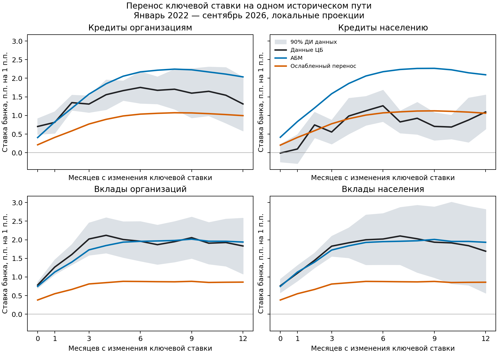
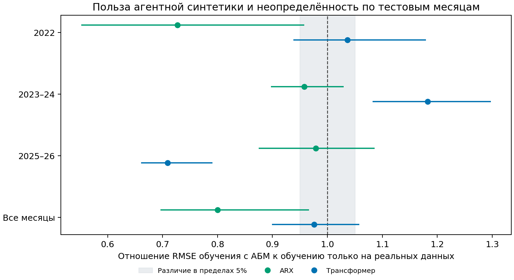
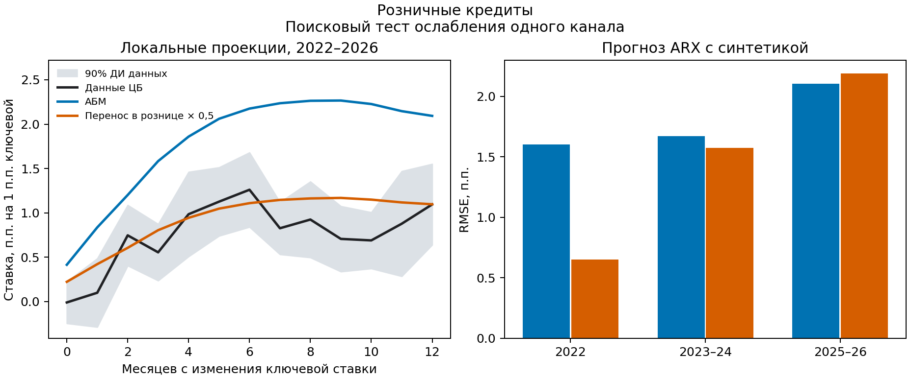

# Перенос ключевой ставки в АБМ и польза её синтетики для прогноза

**21 ноября 2026 года · Рабочий отчёт по эксперименту**

## Коротко

- **Перенос ключевой ставки лучше воспроизводится для вкладов.** По розничным кредитам оценённый отклик через три месяца составляет 0,56 п.п. в данных ЦБ и 1,58 п.п. в АБМ на 1 п.п. изменения ключевой ставки.
- **Польза синтетики зависит от прогнозиста и окна.** На 43 тестовых месяцах RMSE у ARX с синтетикой АБМ ниже на 20,0% при двухмесячной задержке публикации банковских ставок и на 6,5% при трёхмесячной. У трансформера совокупное снижение составляет 2,4%. В 2025–2026 годах ошибка трансформера падает на 29,1%, а в 2023–2024 годах растёт на 18,2%.
- **Линейный двойник и простое уравнение переноса дают близкую совокупную точность.** В поисковом тесте ослабление только розничного переноса приблизило отклик к данным и снизило RMSE розничной ставки у ARX с 1,60 до 0,65 п.п. в 2022 году. В 2025–2026 годах ошибка выросла с 2,11 до 2,19 п.п.

## 1. Исследовательский вопрос

Улучшает ли добавление синтетики АБМ прогноз ставок российских банков и какая часть симулятора даёт этот результат?

Для ответа проверяем две вещи. Сначала оцениваем, воспроизводит ли АБМ величину и скорость переноса ключевой ставки в ставки по кредитам и вкладам. Затем проверяем, меняется ли ошибка на реальных рядах, если обучать один и тот же прогнозист с синтетикой из разных источников. Первая проверка описывает процентный блок АБМ, вторая измеряет его полезность для конкретной прогнозной задачи. [Протокол прогона](protocol.json)

## 2. Данные и дизайн

Использованы четыре месячных ряда Банка России в рублях — ставки по кредитам и вкладам организаций и населения. Для АБМ взята калибровка **B** за январь 2017 — декабрь 2021 года, версия исходного кода `05cd15e`. При проверке откликов модель получает фактический месячный путь ключевой ставки с 24 месяцами прогрева. Сравнение охватывает январь 2022 — сентябрь 2026 года. На данных и результатах модели оценены одинаковые локальные проекции. Основные горизонты — 0, 1, 3 и 6 месяцев. Симуляции повторены с 50 зёрнами. [Данные о банковских ставках](https://www.cbr.ru/statistics/bank_sector/int_rat/) · [Код подготовки данных и проверки переноса](data_sources.py)

Прогноз выпускается в конце месяца на следующий календарный месяц. На эту дату используется ключевая ставка по месяц выпуска включительно и банковские ставки с условной задержкой в два месяца. ARX дополнительно пересчитан с задержкой в три месяца. Такой дизайн учитывает порядок доступности наблюдений приближённо. Используется один сохранённый срез данных ЦБ. Для каждого окна прогнозист обучается один раз на наблюдениях, доступных к первому выпуску, затем получает обновлённый контекст. [Календарь публикаций ЦБ](https://www.cbr.ru/calendar/) · [Код бэктеста](backtest.py)

| Окно | Месяцы цели | Число месяцев |
|---|---|---:|
| B | Март — декабрь 2022 | 10 |
| E | Июль 2023 — декабрь 2024 | 18 |
| F | Июль 2025 — сентябрь 2026 | 15 |

Март 2022 года — первая цель, для которой при двухмесячной задержке к дате выпуска доступна вся история калибровки B. При трёхмесячной задержке окно B начинается с апреля. Окна B и E использовались в предыдущих экспериментах. Окно F впервые вошло в этот прогнозный бэктест, но его месяцы пересекаются с более ранней диагностикой откликов.

Для регуляризованного ARX и небольшого трансформера сравнили обучение на реальных данных и четыре варианта смеси с 50% синтетики. Проверяли синтетику полной АБМ, её линейного VARX-двойника, уравнения частичной подстройки по данным ЦБ и АБМ с вдвое ослабленными прямыми коэффициентами переноса во всех четырёх ставках. Синтетические источники получают одинаковые пути ключевой ставки. Для исходной и ослабленной АБМ также совпадают случайные зёрна и выборки остальных параметров. Использованы три повтора по 300 историй длиной 120 месяцев. Базовый прогноз — последнее доступное значение ставки.

## 3. Как АБМ воспроизводит перенос

Среднеквадратическое расхождение коэффициентов локальных проекций составляет **0,438** для исходной АБМ и **0,686** при ослаблении переноса сразу во всех четырёх ставках. Исходная АБМ укладывается в описательный допуск 0,25 п.п. в **8 из 16** ячеек «ряд × горизонт», ослабленная — в **3 из 16**. Средний отклик АБМ попадает в 90%-й интервал эмпирических оценок в 10 и 4 ячейках соответственно. [Сводка проверки переноса](results/transfer_summary.csv) · [Оценки по рядам и горизонтам](results/transfer_comparison.csv)

| Ряд | ЦБ, h = 3 | АБМ, h = 3 | АБМ с ослабленным переносом, h = 3 |
|---|---:|---:|---:|
| Кредиты организациям | 1,31 | 1,57 | 0,77 |
| Кредиты населению | 0,56 | 1,58 | 0,78 |
| Вклады организаций | 2,02 | 1,73 | 0,81 |
| Вклады населения | 1,83 | 1,72 | 0,81 |

Отклик выражен в п.п. банковской ставки на 1 п.п. изменения ключевой ставки. В данных он отражает связь с фактической траекторией политики, включая дальнейшие изменения ключевой ставки и сопутствующие события. Для проверки действия правила внутри модели отдельно симулировали ступень +2 п.п. против постоянной ставки. На горизонте трёх месяцев отклик розничной ставки в этом эксперименте составляет 0,85 п.п. на 1 п.п. в исходной АБМ и 0,43 п.п. в ослабленной. [Профили исторического и ступенчатого отклика](results/transfer_profiles.csv)

**Вывод по первой гипотезе.** Исходная АБМ близко воспроизводит динамику вкладов на историческом пути. В розничных кредитах перенос избыточен и проявляется раньше, чем в данных. Ослабление переноса сразу во всех сегментах исправляет часть расхождения в рознице ценой ухудшения откликов вкладов.

## 4. Помогает ли синтетика прогнозу

Совокупная RMSE на 43 месяцах, п.п. Вес одинаков для каждого месяца и ряда. В таблице показана ошибка прогноза, усреднённого по трём повторам. [Полная таблица RMSE](results/forecast_summary.csv) · [RMSE по отдельным повторам](results/forecast_repetitions.csv)

| Прогнозист | Последняя ставка | Только реальные | + АБМ | + Двойник | + Уравнение переноса | + Ослабленная АБМ |
|---|---:|---:|---:|---:|---:|---:|
| ARX | 3,085 | 2,660 | 2,129 | 2,128 | 2,170 | 2,179 |
| Трансформер | 3,085 | 2,261 | 2,206 | 2,258 | 2,185 | 2,411 |

Ниже — отношение RMSE обучения с синтетикой полной АБМ к обучению только на реальных данных. Значение ниже единицы соответствует снижению ошибки. В скобках центральный 90%-й интервал парного блочного бутстрэпа по тестовым месяцам. В один блок попадают одновременно ошибки всех четырёх ставок. Длина блока — три месяца. [Отношения RMSE и интервалы](results/forecast_ratios.csv)

| Окно | ARX | Трансформер |
|---|---:|---:|
| B — 2022 | 0,727 [0,552–0,958] | 1,036 [0,938–1,179] |
| E — 2023–2024 | 0,958 [0,897–1,030] | 1,182 [1,082–1,298] |
| F — 2025–2026 | 0,979 [0,875–1,086] | 0,709 [0,661–0,791] |
| Все окна | 0,800 [0,696–0,966] | 0,976 [0,899–1,058] |

- **ARX.** Основной выигрыш приходится на 2022 год. Без апреля 2022 года совокупное отношение RMSE повышается с 0,800 до 0,915. При трёхмесячной задержке совокупное отношение составляет 0,935 [0,840–1,058]. Этот вариант одновременно меняет объём доступной информации и убирает март из окна B. При сравнении на общих месяцах двухмесячная задержка даёт 0,725, трёхмесячная — 0,935. [Удаление по одному месяцу](results/forecast_leave_one_month.csv) · [График ошибок по месяцам](results/forecast_monthly_difference.png)
- **Трансформер.** В окне F выигрывает синтетика всех четырёх источников относительно обучения только на реальных данных. Самую низкую RMSE в этом окне даёт синтетика простого уравнения переноса — **1,345 п.п.** против **1,481 п.п.** у полной АБМ и **1,746 п.п.** у последнего доступного значения ставки. В окне E минимальная RMSE у трансформера, обученного только на реальных данных, — **1,350 п.п.** [Сводка по окнам](results/forecast_summary.csv)
- **Вклад полной АБМ.** Совокупное отношение RMSE АБМ к двойнику равно 1,000 для ARX и 0,977 для трансформера. Против простого уравнения переноса — 0,981 и 1,010. Вывод по точечным оценкам ограничен этими прогнозистами, кратким горизонтом и тремя эпизодами. [Сравнения источников](results/forecast_ratios.csv)

## 5. Поисковая проверка розничного переноса

После просмотра результатов ARX провели отдельный эксперимент. Вдвое ослабили **только** прямой перенос в ставке по кредитам населению и повторили проверку на тех же сценариях. Отклик через три месяца изменился с **1,58 до 0,81 п.п.** при оценке **0,56 п.п.** в данных. Среднеквадратическое расхождение по 16 ячейкам отклика снизилось с **0,438 до 0,208**.

| Окно | Последняя ставка | ARX только на реальных данных | ARX с исходной АБМ | ARX с ослаблением только в рознице |
|---|---:|---:|---:|---:|
| B — 2022 | 2,530 | 1,298 | 1,601 | 0,653 |
| E — 2023–2024 | 2,282 | 1,544 | 1,670 | 1,574 |
| F — 2025–2026 | 2,097 | 2,263 | 2,105 | 2,188 |

В таблице RMSE прогноза ставки по кредитам населению, п.п. В 2022 году исходная АБМ ухудшает прогноз ARX относительно обучения на реальных данных, а версия с ослабленным переносом улучшает его. При удалении любого из десяти месяцев отношение ошибок изменённой и исходной АБМ остаётся в пределах **0,336–0,493**. В окне F оно превышает единицу при каждом таком удалении. По всем четырём ставкам и трём окнам изменение снижает RMSE с 2,129 до 2,099 п.п., примерно на 1,4%. Это результат **поисковой** проверки на уже рассмотренных окнах. [Базовые прогнозы по сегментам](results/forecast_by_rate.csv) · [Отклик после изменения правила](results/exploratory_retail_transfer.csv) · [Проверка чувствительности к отдельным месяцам](results/exploratory_retail_summary.csv)

## 6. Что следует для статьи

**Рабочий вывод.** На этих данных прогнозная польза синтетики зависит от окна и метода обучения. Сравнение с двойником и уравнением переноса показывает, какую точность дают более простые генераторы. Розничный эксперимент даёт пример, где изменение конкретного правила одновременно приближает отклик к данным и улучшает прогноз в одном режиме. В другом режиме то же изменение ухудшает прогноз.

**Ограничения.** Три исторических окна дают мало независимых эпизодов. Бутстрэп показывает неопределённость по тестовым месяцам внутри этих окон при фиксированных обученных ансамблях. Историческая доступность банковских ставок задана через приближённую задержку, а результаты ARX чувствительны к её выбору. ARX и трансформер различаются по признакам, длине контекста и способу обучения. Вывод об устойчивости относится к двум прогнозным спецификациям. В АБМ текущие депозитные котировки взвешены по остаткам вкладов, а ставки ЦБ рассчитаны по новым операциям. Локальные проекции на историческом пути описывают наблюдаемую динамику переноса. Для причинного вывода о политике нужен отдельно идентифицированный шок. [Подготовка признаков и обучение прогнозистов](backtest.py)

**Следующая подтверждающая проверка.** Заранее задать правило оценки розничного переноса на обучающих данных. Проверить его на новых прогнозных датах и у обоих прогнозистов. Основной показатель — парная разница ошибок для ставки по кредитам населению. Совокупную RMSE по четырём рядам оставить дополнением, чтобы было видно, приносит ли локальное улучшение пользу всему прогнозу.

## 7. Проверка с оценкой розничного переноса на дату прогноза

**Протокол зафиксирован 21.11.2026 до расчёта.** Использованы январь–июнь 2023 и январь–июнь 2025 года. В предыдущем прогнозном бэктесте на этих месяцах ошибки не оценивались. Они входили в общую диагностику откликов и частично в обучение для более поздних окон. Для расчёта доступности ставки использованы даты последнего обновления официальных месячных комментариев ЦБ. Во всех 12 выпусках последняя документированная ставка относится к месяцу выпуска минус два. Даты подтверждают, что ряд был публичен к соответствующей отсечке. Исторические версии значений остаются ограничением. [Протокол](confirmation/protocol.json) · [Архивные даты ЦБ](confirmation/cbr_release_dates.csv)

В каждом окне коэффициент оценён из уравнения частичной подстройки по истории, доступной к первому выпуску, и подставлен только в прямой розничный канал АБМ. Получилось **1,347** по истории до октября 2022 и **1,090** по истории до октября 2024. Обе оценки выше исходного коэффициента АБМ, равного **1,0**. Поисковая поправка **0,5** из раздела 5 соответствовала другому эксперименту.

| Прогнозист и окно | Исходная АБМ | АБМ с оценённым переносом | Синтетика простого уравнения | Только реальные данные |
|---|---:|---:|---:|---:|
| ARX · январь–июнь 2023 | 0,852 | 0,808 | 0,785 | 1,015 |
| ARX · январь–июнь 2025 | 2,123 | 2,145 | 2,429 | 2,021 |
| **ARX · оба окна** | **1,617** | **1,621** | **1,805** | **1,599** |
| Трансформер · оба окна | 1,983 | 2,375 | 1,882 | 1,755 |

RMSE указана в п.п. для ставки по кредитам населению. Основное сравнение даёт отношение **1,002** по двум окнам при заранее заданном пороге улучшения **0,95**. В 2023 году точечное улучшение составило 5,1%, в 2025 году ошибка выросла на 1,0%. У трансформера с одним заранее выбранным зерном RMSE выросла на 19,8%. Вывод относится к конкретному правилу подстановки коэффициента, двум коротким ретроспективным окнам и выбранным прогнозистам. [Сводка](confirmation/results/historical_summary.csv) · [Помесячные ошибки](confirmation/results/historical_ensemble.csv) · [График ставок и прогнозов](confirmation/results/historical_retail_forecasts.png)

**Перспективный выпуск от 21.11.2026.** Цель — средневзвешенная ставка по новым рублёвым кредитам населению за декабрь 2026 года. Последнее документированное банковское наблюдение — сентябрь. Коэффициент по доступной истории — **0,725**. Прогнозы ARX составляют **17,04%** с исходной АБМ, **17,17%** с оценённым переносом и **17,15%** с синтетикой простого уравнения. Прямой прогноз самого уравнения — **16,92%**. Прогнозы обоих методов и входной срез сохранены до начала декабря. Итоговая проверка запланирована на шесть целевых месяцев с декабря 2026 по май 2027 года. Ошибки рассчитываются по мере появления фактов, отдельно от файлов прогнозов. [Зафиксированные прогнозы](confirmation/results/prospective_2026-11-21/frozen_forecasts.csv) · [Контрольные суммы](confirmation/results/prospective_2026-11-21/forecast_hashes.json) · [Источник сентябрьского наблюдения](https://www.cbr.ru/statistics/bank_sector/int_rat/0926/)

**Оговорка по старому окну 2022 года.** При аудите ставок, которые использовал прежний бэктест, обнаружилось, что страницы за январь и февраль 2022 года обновлены 24 мая. Даты могут отражать правку более ранней публикации. Для апрельского прогноза доступность январского ряда к 31 марта требует отдельного подтверждения по первоначальному выпуску. [Датировка архивных страниц 2022 года](confirmation/cbr_2022_timing_audit.csv)

## Материалы прогона

- [Зафиксированный протокол](protocol.json) · [Контрольные суммы исторического прогона](results/manifest.json). Пути указаны от корня репозитория. Для двух скриптов, у которых при переносе обновились пути, манифест ссылается на архивные версии.
- [Все усреднённые прогнозы по месяцам](results/forecast_ensemble.csv) · [RMSE по сегментам](results/forecast_by_rate.csv)
- [Проверка датировки и контроль с известным сигналом](check_design.py) · [Контрольные оценки](results/positive_control.csv). В контрольном симуляторе верное правило дало меньшую RMSE во всех 60 сравнениях с генератором, пропускающим специально заложенный сильный сигнал.
- [Поисковый тест розничного переноса](retail_sensitivity.py) · [Код формирования таблиц и графиков](summarize.py)
